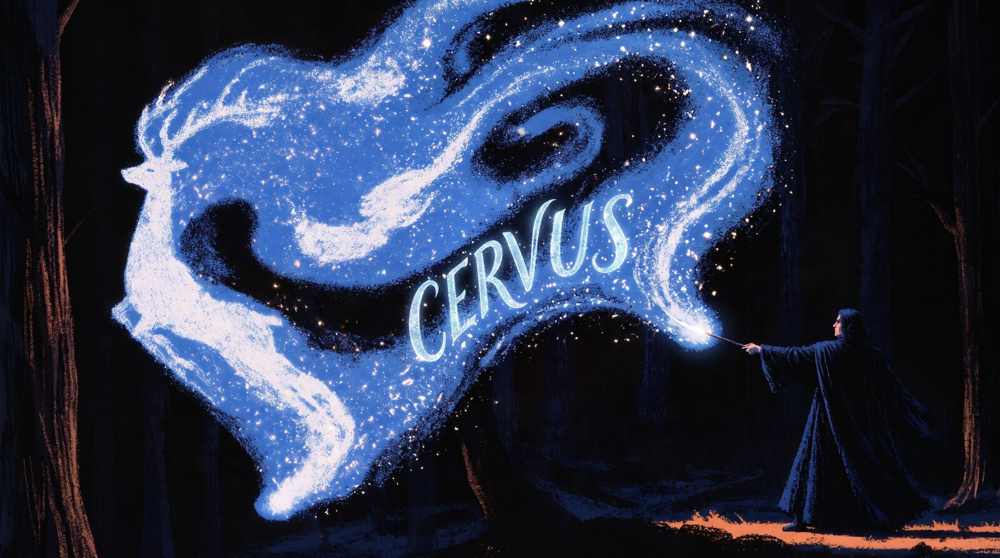

# Cervus



Encrypted AWS secrets and role switching for your terminal. Run it once; it stays in the background.

> Status: pre-release (v0.0.5). The vault and the AWS role/MFA flow work and are tested against a fake STS server and passed one limited real-AWS test pass on Linux. MFA enrollment by QR and the OS keychain are not built. Do not use it for production credentials until it has had a full real-AWS test pass and an independent security review.

## What works today

- Encrypted vault (age): `init`, `unlock`/`lock`, `secret put|get|list|rm`, recovery key, idle auto-lock, crash-safe supervision.
- AWS identities: `identity add` stores an IAM access key in the vault (checked with `GetCallerIdentity`). `identity mfa-import` stores a virtual-MFA seed device-only; the vault computes TOTP codes.
- Changing things later: `identity update --rotate-key` replaces a key without touching its roles or MFA seed, `role edit` changes only the settings you name, and `passwd` changes the passphrase.
- Roles: `role add` with `--mfa none|once|always`, `--confirm`, `--duration`. `once` fetches one MFA-backed session token and assumes roles from it; `always` uses a fresh code every time.
- Per-shell sessions: `CERVUS_SESSION=<id> cervus use <role>`. Two shells can hold two roles.
- Shell integration: `cervus init-shell zsh --install` (or bash). Each shell gets its own session, `Alt+r` opens a role picker, and an optional prompt segment shows `[role 45m]` (green, red for protected roles, yellow when expired). Sessions of closed shells are cleaned up.
- `cervus migrate`: moves plaintext keys from `~/.aws/credentials` into the vault (each key is checked with AWS and read back before the plaintext is removed) and imports role profiles from `~/.aws/config`.
- `cervus doctor`: checks the login service, permissions, plaintext leftovers, the AWS profile, shell setup and missing MFA seeds, and tells you the fix for each.
- `cervus install-service` / `uninstall-service`: run `cervusd` at login as a systemd user unit. A launchd agent is generated on macOS, but its behavior is unverified. The vault stays locked until you unlock it.
- `cervus recover`: lost your passphrase? The recovery key re-encrypts synced secrets for a new device key (device-only secrets such as MFA seeds cannot be recovered).
- `cervus audit` / `cervus audit verify`: hash-chained log of security events (never contains secrets). Lives next to `config.json`.
- AWS CLI integration: `cervus aws-profile --install` adds a profile whose `credential_process` is `cervus credential-process`. Credentials stay in daemon memory and are refreshed before expiry.

## Try it

```sh
make build && export PATH="$PWD/bin:$PATH"
cervus install-service   # starts cervusd now and at every login (or run `cervusd &` by hand)
cervus init
cervus identity add work --region eu-west-1 --mfa-serial arn:aws:iam::<acct>:mfa/<name>
cervus identity mfa-import work                      # paste the base32 seed
cervus role add dev  --identity work --arn arn:aws:iam::<acct>:role/Dev
cervus role add prod --identity work --arn arn:aws:iam::<acct>:role/Prod --mfa always --confirm
cervus aws-profile --install
cervus init-shell zsh --prompt --install     # or bash; then open a new terminal
# press Alt+r to pick a role, or: cervus use dev
aws sts get-caller-identity
```

## Architecture

```
cervus (CLI) --> cervusd (Go daemon) --stdio pipe--> cervus-vault (Rust child)
 aws CLI --credential_process--^   |                  age crypto, TOTP, zeroized keys
                                   +--> AWS STS (own SigV4 client, no SDK)
```

| Binary | Language | Role |
|---|---|---|
| `cervus` | Go | CLI client, `credential-process` helper |
| `cervusd` | Go | Daemon: sessions, credential cache and refresh, STS calls, allowlisted API |
| `cervus-vault` | Rust | Encryption, key handling, TOTP, idle auto-lock |

The vault has no socket on disk; only the daemon can reach it. See `docs/PROTOCOL.md`.

## Build and test

Requirements: Go 1.22+, Rust 1.74+, Python 3.

```sh
make test     # unit tests + 4 end-to-end suites (vault, AWS with a fake STS, migrate/doctor, shell in a pty); ~3 minutes
```

The AWS signer is checked against the official AWS SigV4 example, and TOTP against the RFC 6238 vectors. The fake STS recomputes TOTP independently, so MFA codes are cross-checked.

## Known limitations

- Real-AWS testing is partial: role switching with and without MFA and `credential_process` passed on Linux; credential refresh, `cervus migrate` and the shell picker have not been tried there. In one test AWS rejected a reused TOTP code, and Cervus refuses to reuse a code and tells you how long to wait.
- MFA enrollment by QR code is not built yet; import an existing seed instead.
- The picker and prompt are tested with bash 5.2 and zsh 5.9 in a pseudo-terminal, not in macOS Terminal, iTerm2 or with oh-my-zsh themes. In zsh the segment is added to `RPROMPT`; in bash it is prefixed to `PS1` and refreshes after the next command. On macOS, `Alt+r` needs "Use Option as Meta key" in your terminal.
- `cervus lock` drops cached credentials, but the vault's idle auto-lock does not (yet) clear the daemon's cache.
- The device key is protected by a passphrase; the OS keychain backend is planned.
- macOS code paths (peer UID check, ptrace denial) are untested.
- Go cannot zeroize memory; secrets passing through the daemon are not wiped.
- The audit log detects edits and deletions in the middle, but not truncation of its end.
- Secret names are visible as file names. Removing a git recipient does not hide old history; rotate the secret.

## Roadmap

1. Done: vault core.
2. Done (mock-tested): identities, roles, TOTP, per-shell sessions, credential_process.
3. Partly done: real-AWS test pass (see Known limitations); fixes.
4. Done (tested in a pty): shell hook, Alt+r picker, prompt segment, session cleanup.
5. Done: plaintext key migration, `cervus doctor`, recovery flow, audit log. Open: MFA enrollment with QR.
6. OS keychain backend, git sync helpers and pre-push guard.
7. Hardening, audit log, independent security review.
